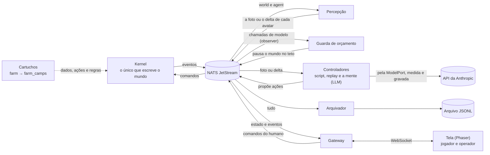

# Campsverso

[](https://github.com/campilho/campsverso/actions/workflows/check.yml)

Plataforma de simulação orientada a eventos para agentes autônomos que vivem em mundos 2D. Os avatares podem ser controlados por humanos, por scripts e, a partir da v0.2, por LLMs.

Cada mundo é um **cartucho** (fazenda, estúdio, vilarejo…) rodando sobre um **kernel** genérico. O kernel conhece a "física" de um mundo simulado: tempo, espaço, entidades, itens, necessidades, ações e regras. Isso inclui **regras ocultas**, que os agentes precisam descobrir observando o mundo.

Projeto pessoal de aprendizado, construído em público com a ajuda do Claude Code e documentado passo a passo.

## Status

**v0.1.0 "Fazenda do Camps"**, a primeira versão: um avatar, nenhum LLM; controladores humano, script e replay. Os 11 critérios de aceite estão conferidos em [aceite-v0.1.md](docs/aceite-v0.1.md), e os números da construção em [a v0.1 em números](docs/diario/README.md#a-v01-em-números). Detalhes no [escopo da v0.1](docs/arquitetura/escopo-v0.1.md).

| Marco | Situação |
|---|---|
| M0: fundação (monorepo, contratos, codegen, CI) | concluído |
| M1: kernel sem barramento (modelo de mundo, relógio, ações, regras, cartuchos farm e farm_camps) | concluído |
| M2: durabilidade (NATS, outbox, arquivo JSONL, snapshots, retomada) | concluído |
| M3: controladores headless (percepção, fazendeiro-script, replay, modo máximo) | concluído |
| M4: UI de depuração (gateway WebSocket, canvas, visões jogador/operador, controles do relógio) | concluído |
| M5: controlador humano (clicar para mover, menu de ações, assumir e devolver a posse) | concluído |
| M6: renderer Phaser (arte LPC, mapa visual, o Camps animado, retrato e créditos) | concluído |
| M7: fechamento (métricas da bíblia no painel do operador, critérios de aceite da v0.1) | concluído |

## Próximo: v0.2, a possessão

A pergunta da v0.2: **um LLM consegue viver na fazenda, prosperar e descobrir sozinho a regra oculta do rio?** E como ele se compara ao fazendeiro-script, a um humano e a outros modelos, no mesmo mundo e com as mesmas métricas? O plano completo está em [v0.2-macro.md](docs/planos/v0.2-macro.md).

| Marco | Entrega |
|---|---|
| M8: mundo pronto para o LLM | o agente enxerga o mapa, percepção por deltas, fome e vigília com custo |
| M9: porta de modelo e orçamento | `ModelPort`, eventos das chamadas, teto de custo que pausa o mundo, respostas gravadas para testes |
| M10: o controlador LLM | o Camps decide pela percepção e pelo catálogo de ações, com um cartão de identidade |
| M11: memória baseline | registrar, lembrar e refletir; crenças com confiança e origem |
| M12: a arena | humano × script × dois modelos, lado a lado, com o custo por dia simulado |
| M13: fechamento | critérios de aceite, diário e a tag `v0.2.0` |

**M8 concluído em 17/out/2026** ([plano](docs/planos/m8-mundo-pronto-para-o-llm.md), ADR-0056 e ADR-0057): o terreno e o raio no `session.started`, a foto com mapa, o delta `perception.updated.v1`, acordado custa energia e a fome no teto drena, e `make percepcao` mede o custo em tokens.

**M9 concluído em 18/out/2026** ([plano](docs/planos/m9-porta-de-modelo-e-orcamento.md), ADR-0058): a `ModelPort` com o adaptador da API da Anthropic, a fita que grava e reproduz respostas, o medidor que publica cada chamada como evento com tokens e custo, e a guarda de orçamento que pausa o mundo no teto. A primeira chamada real custou US$ 0,000124; a calibração mostrou 2,1 caracteres por token no JSON da percepção.

**M10 em curso** ([plano](docs/planos/m10-controlador-llm.md), ADR-0059): a mente, uma biblioteca genérica que conversa com o modelo pela porta, com o cartão de identidade e o catálogo de ações como dados do cartucho.

## Depois: v0.3, o escritório que constrói a si mesmo

Em vez de outra fazenda, um escritório de programação com um único dev no começo, cujo trabalho é melhorar o próprio Campsverso: ele recebe tickets de nós, abre PRs, espera o CI, e quando um PR é mesclado o mundo reinicia na versão que ele mesmo escreveu. Depois ele propõe um ajudante. É o primeiro cartucho com efeitos externos; a v0.2 inteira é pré-requisito. A ideia está em [ideia-escritorio-que-se-constroi.md](docs/planos/ideia-escritorio-que-se-constroi.md), a direção na [ADR-0055](docs/decisoes/0055-a-v0-3-e-o-escritorio-que-se-constroi.md) e as telas propostas em [docs/design](docs/design/README.md).




- **O kernel é o único que escreve o mundo.** Controladores (o humano, o script, o replay e, na v0.2, um LLM) só propõem ações; o kernel valida, aplica e publica os fatos.
- **Tudo passa pelo barramento como evento,** com um contrato (JSON Schema) para cada tipo. Os serviços não importam o código uns dos outros.
- **A visibilidade é garantida pelas permissões do NATS.** Os efeitos da regra oculta são eventos `internal`, que os controladores não conseguem assinar.
- **O cartucho traz o mundo:** culturas, preços, ações, menus, métricas, mapa e arte. O kernel só conhece a física genérica (tempo, espaço, itens, necessidades, ações e regras).

## Como começar

Requisitos: [uv](https://docs.astral.sh/uv/) e [pnpm](https://pnpm.io/). O uv instala o Python 3.14; o pnpm usa o Node 24 fixado no projeto.

```bash
make setup   # dependências Python e TypeScript, e o nats-server com versão fixa
make check   # lint, tipos, testes, arquitetura e contratos
make sandbox # um mundo descartável com tudo ligado; a UI fica em http://127.0.0.1:8765/?view=operator
make run     # o mundo oficial: NATS, kernel, percepção, fazendeiro-script, arquivador, gateway e guarda de orçamento
make stop    # derruba o NATS
make ui      # a UI em modo desenvolvimento (Vite), ligada ao gateway do run ou do sandbox
make ui-e2e  # fumaça da tela num navegador de verdade (Playwright), com um sandbox próprio
make mapa-visual    # regrava o mapa visual da fazenda a partir do mapa lógico
make soak DAYS=30   # 30 dias simulados em modo máximo, com processos e NATS próprios
make sessoes MARCO=M6   # tempo e tokens do Claude Code por marco, em docs/custos/
make metrics        # métricas do mundo a partir do arquivo de eventos
make percepcao      # fotos e deltas da percepção por dia, em bytes e tokens estimados (ADR-0056)
make llm-smoke      # uma chamada real pela porta de modelo, medida e publicada pelo contrato (ADR-0058)
make fita DIAS=1    # grava em processo a fita de teste do controlador LLM, chamando a API (ADR-0059)
make help    # todos os alvos
```

O `make run` gera as senhas locais do NATS em `.env`, fora do git. O mundo fica em `data/farm-camps-01/` (estado e snapshots) e o histórico de eventos em `data/archive/`. A UI abre em `http://127.0.0.1:8765/?view=player` (jogador) ou `?view=operator` (operador, com relógio e linha do tempo). O `make sandbox` faz o mesmo numa pasta própria em `data/sandbox/`, sem tocar no mundo oficial; com `MENTE=camps`, a mente assume o Camps (precisa de `ANTHROPIC_API_KEY` no `.env`).

Para jogar, clique em "Assumir o Camps". O clique esquerdo anda; o clique direito abre o menu de ações da coisa clicada, ou o do próprio Camps. "Devolver ao script" devolve o controle ao fazendeiro-script.

O mapa é desenhado pelo [Phaser](https://phaser.io/) com pixel art do [Liberated Pixel Cup](https://lpc.opengameart.org/). O link "canvas de depuração" volta ao desenho simples, com ids e rótulos, e o link "créditos" lista os autores de cada peça de arte.

## Documentação

- [Arquitetura](docs/arquitetura/): escopo, bíblia do mundo, contratos de eventos, gestão do tempo, catálogo de eventos e pesquisa de componentes. A ordem de leitura está no escopo.
- [Contratos](contracts/): os JSON Schemas de todos os eventos e comandos (fonte da verdade) e o [changelog](contracts/CHANGELOG.md).
- [Decisões (ADRs)](docs/decisoes/README.md)
- [Referências visuais](docs/design/README.md): as telas propostas da fazenda, do escritório e do estúdio, e o que cada uma ensinou
- [Diário de bordo](docs/diario/)
- [Custos de desenvolvimento](docs/custos/): tempo e tokens do Claude Code por marco

## Licença

O código é [MIT](LICENSE). A arte em `cartridges/*/art/` é CC-BY-SA 3.0 ou GPL 3.0, como as originais do LPC, e exige crédito a cada autor: veja o `CREDITS.csv` de cada pasta.
