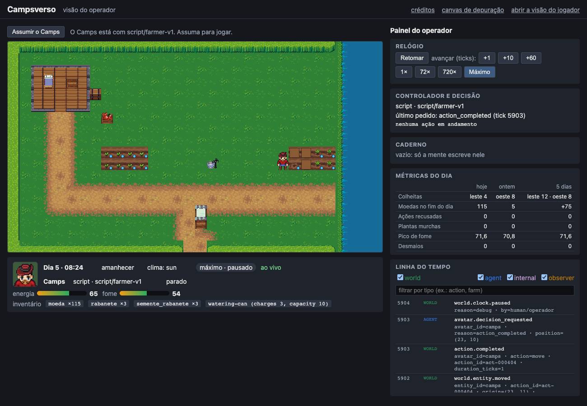
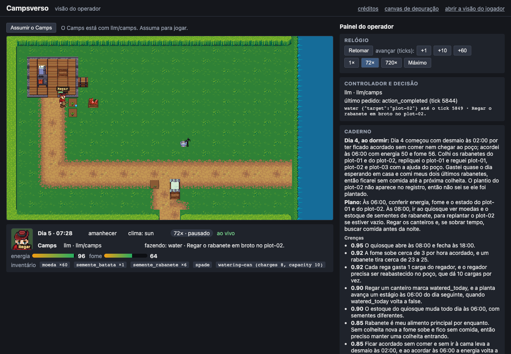
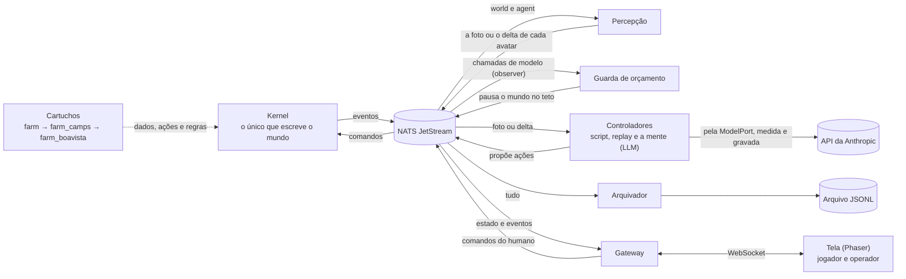

# Campsverso

[](https://github.com/campilho/campsverso/actions/workflows/check.yml)

Plataforma de simulação orientada a eventos para agentes autônomos que vivem em mundos 2D. Os avatares podem ser controlados por humanos, por scripts e, a partir da v0.2, por LLMs.

Cada mundo é um **cartucho** (fazenda, estúdio, vilarejo…) rodando sobre um **kernel** genérico. O kernel conhece a "física" de um mundo simulado: tempo, espaço, entidades, itens, necessidades, ações e regras. Isso inclui **regras ocultas**, que os agentes precisam descobrir observando o mundo.

Projeto pessoal de aprendizado, construído em público com a ajuda do Claude Code e documentado passo a passo.

## Versões

Cada versão responde a uma pergunta. As publicadas têm notas, critérios de aceite conferidos e os números da construção; cada marco teve um plano aprovado antes do código.

### v0.1.0 — Fazenda do Camps (12/out/2026)

A pergunta: **a arquitetura orientada a eventos, com módulos totalmente independentes, funciona e aguenta rodar dias seguidos?** Sim: 30 dias simulados em 35 s, determinística, e voltando de um `kill -9` sem perder nem repetir eventos. Um avatar, nenhum LLM; controladores humano, script e replay.



[Notas](docs/versoes/v0.1.0.md) · [critérios de aceite](docs/aceite-v0.1.md) · [a v0.1 em números](docs/diario/README.md#a-v01-em-números) · [escopo](docs/arquitetura/escopo-v0.1.md)

| Marco | Entrega | Situação |
|---|---|---|
| M0: fundação | monorepo, contratos, codegen, CI | concluído em 11/out/2026 |
| M1: kernel sem barramento | modelo de mundo, relógio, ações, regras, cartuchos `farm` e `farm_camps` | concluído em 11/out/2026 |
| M2: durabilidade | NATS, outbox, arquivo JSONL, snapshots, retomada | concluído em 11/out/2026 |
| M3: controladores headless | percepção, fazendeiro-script, replay, modo máximo | concluído em 11/out/2026 |
| M4: UI de depuração | gateway WebSocket, canvas, visões jogador e operador, controles do relógio | concluído em 12/out/2026 |
| M5: controlador humano | clicar para mover, menu de ações, assumir e devolver a posse | concluído em 12/out/2026 |
| M6: renderer Phaser | arte LPC, mapa visual, o Camps animado, retrato e créditos | concluído em 12/out/2026 |
| M7: fechamento | métricas da bíblia no painel do operador, critérios de aceite | concluído em 12/out/2026 |

### v0.2.0 — A possessão (21/out/2026)

A pergunta: **um LLM consegue viver na fazenda, prosperar e descobrir sozinho a regra oculta do rio?** Viver e prosperar, sim: o Haiku com memória passou o fazendeiro-script na fazenda 1, e o Opus fez cinco vezes as moedas do script na Fazenda Boa Vista, onde as escolhas custam. Descobrir, não: nenhum controlador achou a regra do rio. Cerca de US$ 47 de API na versão inteira.



[Notas e os marcos um a um](docs/versoes/v0.2.0.md) · [critérios de aceite](docs/aceite-v0.2.md) · [a v0.2 em números](docs/diario/README.md#a-v02-em-números) · [plano macro](docs/planos/v0.2-macro.md) · relatórios da arena: [M12](docs/arena/2026-10-19.md) e [M14](docs/arena/2026-10-20.md)

| Marco | Entrega | Situação |
|---|---|---|
| M8: mundo pronto para o LLM | o agente enxerga o mapa, percepção por deltas, fome e vigília com custo | concluído em 17/out/2026 |
| M9: porta de modelo e orçamento | `ModelPort`, eventos das chamadas, teto de custo que pausa o mundo, respostas gravadas para testes | concluído em 18/out/2026 |
| M10: o controlador LLM | o Camps decide pela percepção e pelo catálogo de ações, com um cartão de identidade | concluído em 18/out/2026 |
| M11: memória baseline | registrar, lembrar e refletir; crenças com confiança e origem | concluído em 19/out/2026 |
| M12: a arena | script × Haiku sem memória × Haiku com memória, 30 dias lado a lado, com o custo e quem descobriu o leste | concluído em 19/out/2026 |
| M13: a Fazenda Boa Vista | um segundo mundo em que as escolhas custam: sete culturas, canteiros cavados, ferramentas com peso, mercado, fogão, validade; o fazendeiro-script 2 | concluído em 20/out/2026 |
| M14: a segunda rodada da arena | script 2 × Haiku × Sonnet × Opus na Boa Vista, com teto por corrida | concluído em 20/out/2026 |
| M15: fechamento | critérios de aceite, diário e a tag `v0.2.0` | concluído em 21/out/2026 |

## Em construção: v0.3.0 — A fazenda sofisticada

A pergunta: **num mundo maior, com estações, encomendas e regras escondidas em lugares que pedem exploração, quem aprende o mundo e lucra com o que aprendeu: um modelo, um script que faz experimentos ou um humano? E quanto vale aprender?** Na v0.2 os modelos planejaram bem, mas ninguém explorou. A v0.3 continua na fazenda, num cenário novo, a Fazenda Morada do Sol: um mapa maior com névoa, canteiros sem teto, um ano com as quatro estações, encomendas e uma economia de oferta e demanda, ajudantes contratáveis, um fazendeiro-script que faz experimentos, um oráculo que conhece as regras e a arena com outras famílias de modelos. Ela também constrói de propósito o que o escritório da v0.4 vai precisar.

[Plano macro](docs/planos/v0.3-macro.md) · [as decisões (ADR-0066)](docs/decisoes/0066-decisoes-do-plano-macro-da-v0-3.md) · [ADR-0064](docs/decisoes/0064-a-v0-3-e-a-fazenda-sofisticada.md) · [a análise da ordem das versões](docs/planos/analise-ordem-v0.3-v0.5.md)

| Marco | Entrega | Situação |
|---|---|---|
| Antes do M16: a rodada do humano da v0.2 | o usuário joga a Boa Vista com a seed da rodada do M14 | as ferramentas prontas; a partida espera uma noite livre |
| M16: a Fazenda Morada do Sol | o cenário novo com o mapa maior e a câmera que rola, canteiros sem teto, o ano acelerado com as quatro estações, as regras ocultas novas, a arte | concluído em 23/out/2026 ([plano](docs/planos/m16-morada-do-sol.md), ADR-0067, [bíblia](docs/arquitetura/fazenda-morada-do-sol-biblia.md)) |
| M17: ver e assistir | a névoa, a noite e a lanterna; a visão arena, com as corridas ao vivo e gravadas; os menus do humano | próximo |
| M18: a economia | um módulo de economia reaproveitável: oferta e demanda, encomendas com prazo, a feira, processamento, clima | a fazer |
| M19: os controladores e a medição | o fazendeiro-script 3, o oráculo, o caderno de campo, a prova do mundo e o juiz, as variantes do mapa | a fazer |
| M20: os ajudantes | vários avatares; cinco personagens contratáveis, cada um com a sua ficha | a fazer |
| M21: a terceira arena | a rodada do humano da v0.3; Claude, script 3 e oráculo; depois GPT e Gemini | a fazer |
| M22: fechamento | critérios de aceite, diário, notas e a tag `v0.3.0` | a fazer |

## Depois: v0.4.0 — O escritório que constrói a si mesmo

Um escritório de programação com um único dev no começo, cujo trabalho é melhorar o próprio Campsverso: ele recebe tickets de nós, abre PRs, espera o CI, e quando um PR é mesclado o mundo reinicia na versão que ele mesmo escreveu. É o primeiro cartucho com efeitos externos. A ideia está em [ideia-escritorio-que-se-constroi.md](docs/planos/ideia-escritorio-que-se-constroi.md) e a direção na [ADR-0055](docs/decisoes/0055-a-v0-3-e-o-escritorio-que-se-constroi.md); a ordem (o escritório na v0.4, o estúdio na v0.5) está na [ADR-0064](docs/decisoes/0064-a-v0-3-e-a-fazenda-sofisticada.md). O plano dele nasce no fim da v0.3.

## Como funciona



- **O kernel é o único que escreve o mundo.** Controladores (o humano, o script, o replay e, desde a v0.2, um LLM) só propõem ações; o kernel valida, aplica e publica os fatos.
- **Tudo passa pelo barramento como evento,** com um contrato (JSON Schema) para cada tipo. Os serviços não importam o código uns dos outros.
- **A visibilidade é garantida pelas permissões do NATS.** Os efeitos da regra oculta são eventos `internal`, que os controladores não conseguem assinar.
- **O cartucho traz o mundo:** culturas, preços, ações, menus, métricas, mapa e arte. O kernel só conhece a física genérica (tempo, espaço, itens, necessidades, ações e regras).
- **A arena roda o mesmo kernel, a mesma mente e a mesma porta de modelo em processo,** sem barramento: o mundo espera cada resposta do modelo, e cada corrida tem o seu teto de custo (ADR-0061).

## Como começar

Requisitos: [uv](https://docs.astral.sh/uv/) e [pnpm](https://pnpm.io/). O uv instala o Python 3.14; o pnpm usa o Node 24 fixado no projeto.

```bash
make setup   # dependências Python e TypeScript, e o nats-server com versão fixa
make check   # lint, tipos, testes, arquitetura e contratos
make sandbox # um mundo descartável com tudo ligado; a UI fica em http://127.0.0.1:8765/?view=operator
make sandbox MUNDO=farm-boavista-01 # o mesmo, na Fazenda Boa Vista
make sandbox MENTE=camps            # o LLM assume o Camps (precisa de ANTHROPIC_API_KEY no .env)
make sandbox MUNDO=farm-morada-do-sol-01  # a Fazenda Morada do Sol (v0.3, em construção)
make run     # o mundo oficial: NATS, kernel, percepção, fazendeiro-script, arquivador, gateway e guarda de orçamento
make stop    # derruba o NATS
make ui      # a UI em modo desenvolvimento (Vite), ligada ao gateway do run ou do sandbox
make ui-e2e  # fumaça da tela num navegador de verdade (Playwright), com um sandbox próprio
make mapa-visual    # regrava o mapa visual da fazenda a partir do mapa lógico
make soak DAYS=30   # 30 dias simulados em modo máximo, com processos e NATS próprios
make sessoes MARCO=M6   # tempo e tokens do Claude Code por marco, em docs/custos/
make metrics        # métricas do mundo a partir do arquivo de eventos
make percepcao      # fotos e deltas da percepção por dia, em bytes e tokens estimados (ADR-0056)
make llm-smoke      # uma chamada real pela porta de modelo, medida e publicada pelo contrato (ADR-0058)
make fita DIAS=2    # grava em processo a fita de teste do controlador LLM, chamando a API (ADR-0059)
make corrida DIAS=7 # N dias em processo com a mente sobre a API, com ou sem memória (ADR-0060)
make arena DIAS=30  # as corridas da arena em data/arena/ (ADR-0061); RODADA=boavista é a segunda rodada, com Sonnet e Opus (ADR-0063)
make arena-report   # o relatório da arena em docs/arena/
make arena-humano SANDBOX=data/sandbox/<pasta>  # a sua partida no sandbox como mais uma corrida da rodada
make help    # todos os alvos
```

O `make run` gera as senhas locais do NATS em `.env`, fora do git. O mundo fica em `data/farm-camps-01/` (estado e snapshots) e o histórico de eventos em `data/archive/`. A UI abre em `http://127.0.0.1:8765/?view=player` (jogador) ou `?view=operator` (operador, com relógio e linha do tempo). O `make sandbox` faz o mesmo numa pasta própria em `data/sandbox/`, sem tocar no mundo oficial; com `MENTE=camps`, a mente assume o Camps (na Boa Vista, `MENTE=camps_boavista`; precisa de `ANTHROPIC_API_KEY` no `.env`). `MUNDO=farm-boavista-01` escolhe a Fazenda Boa Vista no `sandbox`, no `run`, no `soak`, no `replay` e no `metrics`.

Para jogar, clique em "Assumir o Camps". O clique esquerdo anda; o clique direito abre o menu de ações da coisa clicada, ou o do próprio Camps. "Devolver ao script" devolve o controle ao fazendeiro-script.

O mapa é desenhado pelo [Phaser](https://phaser.io/) com pixel art do [Liberated Pixel Cup](https://lpc.opengameart.org/). O link "canvas de depuração" volta ao desenho simples, com ids e rótulos, e o link "créditos" lista os autores de cada peça de arte.

## Documentação

- [Arquitetura](docs/arquitetura/): escopo, bíblia do mundo, contratos de eventos, gestão do tempo, catálogo de eventos e pesquisa de componentes. A ordem de leitura está no escopo.
- [Contratos](contracts/): os JSON Schemas de todos os eventos e comandos (fonte da verdade) e o [changelog](contracts/CHANGELOG.md).
- [Decisões (ADRs)](docs/decisoes/README.md)
- [Referências visuais](docs/design/README.md): as telas propostas da fazenda, do escritório e do estúdio, e o que cada uma ensinou
- [Diário de bordo](docs/diario/)
- [Custos de desenvolvimento](docs/custos/): tempo e tokens do Claude Code por marco

## Licença

O código é [MIT](LICENSE). A arte em `cartridges/*/art/` é CC-BY-SA 3.0 ou GPL 3.0, como as originais do LPC, e exige crédito a cada autor: veja o `CREDITS.csv` de cada pasta.
