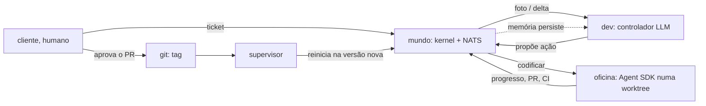

# Ideia: o escritório que constrói a si mesmo

**Status:** escrito em 14/out/2026 como aprofundamento da ideia; em 17/out a direção foi adotada para a v0.3 (ADR-0055); em 20/out o escritório passou para a v0.4, depois da fazenda sofisticada (ADR-0064). As decisões da seção 10 continuam em aberto e vão para o plano macro da v0.3, com decisões numeradas, antes de qualquer código.

## A ideia

Em vez de (ou além de) uma fazenda, um cartucho de **escritório de programação**: um ou dois agentes cujo trabalho é melhorar o próprio Campsverso. Eles recebem requisitos de fora (de nós, como clientes), especificam, pesquisam, codificam, testam e publicam. Ao publicar, o mundo passa a rodar a versão nova; o agente pode ter escrito um ajudante, que passa a trabalhar com ele. O universo constrói a si mesmo. Nós orientamos, revisamos requisitos e aprovamos.

O objetivo final: um escritório de desenvolvimento de software quase todo agêntico e autônomo, com LLMs, orquestração de agentes e memória por trás, e um mundo 2D (ou 3D) em que se vê o escritório trabalhando e no qual se pode entrar.

## 1. O que muda de verdade

Na fazenda, uma ação só muda o estado do mundo dentro do kernel: plantar muda um canteiro, vender muda as moedas. No escritório, o efeito de uma ação vive **fora** do kernel: um repositório, um CI, um PR. "O kernel é o único escritor da verdade do mundo" continua valendo, mas a verdade do código está no git, não no kernel. O escritório seria o primeiro cartucho cujas ações têm **efeitos externos**.

Isso não é um desvio do roteiro: o escopo já previa, para a v0.4, "o estúdio ligado ao pipeline real do podcast". O escritório é o mesmo tipo de coisa, um mundo cujo trabalho tem efeito lá fora, só que o pipeline é o desenvolvimento de software, e o produto é a própria plataforma. A ideia não troca o caminho; ela o reordena e faz o primeiro cartucho ligado ao mundo real produzir o próprio Campsverso.

O que a torna diferente de "um agente de código com um prompt" é o ciclo: o mundo melhora a engine do mundo. E, para ser honesto desde já, o ciclo só fecha passando por um portão humano e pelo CI. O que se constrói é um **ciclo governado**; "quase sozinho" é um botão que se gira aos poucos, não o ponto de partida.

## 2. O que já existe por aí

| Projeto | O que é | Em comum com a ideia | O que falta para ela |
|---|---|---|---|
| **Generative Agents / Smallville** (Stanford, 2023) e **AI Town** (a16z, código aberto) | mundo 2D (Phaser; o AI Town usa Convex e PixiJS) com agentes que têm memória de observação, planejamento e reflexão | o mundo vivo e a memória: é a família da nossa v0.2 | trabalho de verdade; ali o mundo é o produto |
| **ChatDev** e **MetaGPT** (2023) | "empresas de software" de agentes com papéis (CEO, CTO, programador, revisor, testador), em cascata ou por procedimentos padrão com documentos intermediários | papéis e método; o MetaGPT passa documentos estruturados entre papéis, como o nosso plano → ADR → código | mundo persistente, tempo, corpo; cada projeto é de uma vez só; não melhoram a si mesmas |
| **TheAgentCompany** (CMU, 2024/25) | benchmark: agentes como funcionários de uma empresa simulada com GitLab, Plane, RocketChat e ownCloud de verdade; o melhor agente completa 24% a 30% das tarefas, a mais de US$ 4 por tarefa | ferramentas reais e medição séria | é benchmark, não mundo vivo; sem ciclo |
| **Gas Town + Beads** (Steve Yegge, jan/2026) | orquestrador de dezenas de agentes de código com papéis (Mayor, Polecats, Witness, Deacon, Dogs) em "cidades" persistentes sobre repositórios reais; custa milhares por mês em uso pesado | o mais próximo em espírito: uma cidade de operários sobre código real, com papéis e trabalho persistente | o mundo, o corpo, o tempo e a tela; não constrói a si mesmo |
| **Darwin Gödel Machine** (Sakana AI/UBC, 2025; ICLR 2026) | agente de código que edita o próprio código; arquivo de variantes; cada mudança validada em benchmark (SWE-bench de 20% para 50%) | auto-melhoria validada empiricamente, com sandbox e supervisão humana | tudo o que é mundo; melhora um harness, não um produto |
| **Ouroboros** (ago/2026) | harness de código que se desenvolve: ferramentas, prompts e núcleo melhoram por commits **revisados** que viram o runtime das tarefas seguintes; uma instância viva ("Hope") rodou 161 dias | o mais próximo do "publicar e passar a rodar na versão nova"; a governança como problema central | mundo, corpo, equipe |
| **AgentFactory** (ACL 2026) | meta-agente que constrói subagentes como código executável, acumula e reusa | "o agente escreve um ajudante" | o resto |
| **Spec Kit** (GitHub), **Kiro** (AWS), OpenSpec, BMAD | desenvolvimento dirigido por especificação: constituição → especificar → planejar → tarefas → implementar | o nosso método já é isso, com o CLAUDE.md como constituição | são ferramentas, não mundos |
| **Screeps** (jogo) | mundo persistente em que o seu código controla as unidades 24 horas por dia | mundo persistente habitado por programas | os programas não programam |

A Anthropic publicou em junho de 2026 um ensaio sobre IA que constrói a si mesma: os engenheiros dela entregam 8 vezes mais código por trimestre do que em 2021–2025, a melhoria recursiva não é inevitável mas pode chegar antes do que as instituições esperam, e segurança, monitoramento e governança crescem de importância conforme o ciclo aperta. É o enquadramento certo para a publicação que sairia disto.

**Conclusão:** as peças existem; a combinação, até onde a busca alcança, não. Ninguém tem um mundo persistente, visível e habitável cujos moradores fazem trabalho de software de verdade sobre o próprio mundo, com todo o processo registrado como eventos reproduzíveis. O registro é o que daria o material de pesquisa: um arquivo completo de como um software foi construído por agentes, decisão por decisão, chamada por chamada, custo por custo.

## 3. Como encaixa no que temos

O kernel conhece a física de um mundo, não as fazendas (princípio 8). O escritório é outra composição das mesmas primitivas:

| Primitiva | Fazenda | Escritório |
|---|---|---|
| tempo | dias, estações | dias, sprints; o relógio ancorado ao real, que o escopo já previa para a v0.3 |
| espaço | canteiros, poço, casa | mesas, quadro de tarefas, lousa, máquina de café, o botão de publicar |
| entidades e itens | sementes, culturas, moedas | tickets, especificações, PRs, builds; as moedas viram o orçamento em dólares |
| necessidades | fome, energia | energia, foco; café como item |
| ações | plantar, regar, colher, vender | especificar, pesquisar, codificar, testar, revisar, publicar; todas longas e `partial` (ADR-0052) |
| regras | a R-001 oculta | a princípio nenhuma oculta; a regra visível "não se publica com o CI vermelho" |
| controladores | humano, script, replay, LLM (v0.2) | os mesmos; o humano é o cliente; um dev-script é a linha de base |
| métricas (ADR-0054) | colheitas, moedas, recusas | tickets entregues, PRs mesclados, CI verde, rodadas de revisão, custo por ticket, tempo de ciclo |

**Reaproveitado como está:** kernel, contratos, NATS, percepção, arquivador, gateway, a tela (Phaser; há interiores e móveis LPC no OpenGameArt), o manifesto de arte, as métricas, o controlador humano, a camada gênero → cenário (`office` → `office_campsverso`), a política de interrupção. O kernel já itera vários avatares e aceita um controlador por avatar na configuração do mundo.

**Novo:** (a) uma porta para efeitos externos, a "oficina"; (b) o relógio ancorado, ou uma duração atada a um evento externo; (c) vários avatares na percepção, no gateway e na tela (o kernel já tem); (d) o cartucho e a arte do escritório; (e) um supervisor que reinicia o mundo numa versão nova.

Tudo o que a v0.2 planeja é pré-requisito: a `ModelPort` com gravação e reprodução (M9), a guarda de orçamento (M9), o controlador LLM com cartão de identidade e tool use pelo catálogo (M10), a memória que sobrevive a um reinício (M11). O escritório não substitui a v0.2; ele a usa inteira.

## 4. A arquitetura do ciclo: a mente no mundo, as mãos na oficina

A ideia central é separar dois níveis.

**A mente, dentro do mundo.** O controlador do dev (um LLM, pela `ModelPort` da v0.2) decide *o que* fazer a seguir, em tempo simulado e com chamadas baratas: pegar um ticket, especificar, perguntar ao cliente, codificar, testar, publicar. Cada decisão é uma proposta de ação; o kernel valida (não se publica com o CI vermelho; não se codifica sem especificação aprovada, se o método exigir), aplica e publica os fatos. É isso que se vê no mundo 2D: o dev na mesa, a barra de progresso, o quadro com os tickets.

**As mãos, fora do mundo.** Uma ação longa como `codificar` é executada por um adaptador atrás de uma porta (`WorkshopPort`): na prática, uma sessão de agente de código (o Claude Agent SDK, ou o Claude Code sem interface) numa worktree isolada do repositório, com o briefing montado a partir do mundo: o ticket, a especificação, o método, o cartão de identidade. O resultado volta como eventos: `office.work.progressed` (a barra de progresso), `office.pr.opened`, `office.ci.finished`. A ação é `partial`: parar no fim do dia, ou por falta de energia, registra o que foi feito; retomar continua a mesma sessão.

Isso formaliza o que já fazemos hoje: o cliente passa requisitos e um agente de código executa. A diferença é que quem recebe o requisito passa a ser também um agente, com corpo, horário e memória, e o processo inteiro vira eventos.

**Por que dois níveis.** Custo e clareza. A mente faz poucas chamadas por hora simulada; as mãos rodam o ciclo caro e longo, que o Claude Code já resolve bem (o DGM e o Ouroboros reimplementam harnesses de código; não precisamos). E preserva o princípio: o kernel nunca roda git; o adaptador roda, e o kernel escreve o fato.

**Publicar.** O PR é mesclado pelo humano (o portão), ganha uma tag, e um **supervisor** fora do mundo (hoje é o `make run`) reinicia a pilha na versão nova, migrando o snapshot (o `make compat` já garante a compatibilidade dos contratos) e preservando a memória dos agentes (o critério "a memória sobrevive a um reinício" do M11 vira essencial). O mundo acorda na versão nova: um `world.session.started` com a versão, e o dev lê no próprio diário que o mundo mudou.

**O ajudante.** Um agente novo é um cartão de identidade, um papel, um subconjunto do catálogo e um orçamento, como **dados** do cenário (`roles.yaml`) e um avatar no mapa. O dev propõe o ajudante por PR, como qualquer mudança; o humano mescla; o mundo reinicia com dois avatares, e o controller-runner sobe um controlador LLM para cada um. Ajudantes com código próprio ficam para depois: dados primeiro, porque são baratos e revisáveis.

## 5. Governança

- **O portão humano.** Nada é mesclado sem o cliente. A autonomia cresce baixando o portão por caminho: documentação e testes primeiro, dados do cartucho depois, código por último, a constituição nunca.
- **A constituição.** CLAUDE.md, os princípios, os contratos (`make compat`), a guarda de orçamento, o CI e a própria configuração de governança: os agentes leem, propõem mudanças por PR, mas nunca aplicam. Nenhum agente edita testes para passar nem desliga verificações.
- **O CI como juiz.** O `make check` precisa ser real; a v0.1 ensinou que um `tee` sem `pipefail` deixa tudo falsamente verde.
- **Orçamento.** A guarda do M9 (`ops.budget.*`) por ticket e por dia. Estourar pausa o dev, que "fica sem energia". O custo vira um recurso visível no mundo, como as moedas na fazenda. Para referência, o TheAgentCompany mede mais de US$ 4 por tarefa no melhor agente, e o Gas Town custa milhares por mês em escala; um dev fazendo poucos tickets por dia deve custar dezenas de dólares por dia, a medir.
- **Isolamento.** As mãos trabalham numa worktree sem segredos, sem rede além da API do modelo e do push para um branch; nunca nos arquivos do mundo que está rodando, nunca em `data/archive/`.
- **Tudo é evento.** O arquivo de cada ticket (decisões, chamadas, custos, recusas) é o material da publicação, e o replay é o que permite auditar.

É o mesmo regime em que o DGM e o Ouroboros operam (sandbox e supervisão humana), e é o ponto do ensaio da Anthropic: quanto mais o ciclo aperta, mais importa como se monitora e se governa.

## 6. Quem é o primeiro agente

Um dev generalista, o "dev dos anos 80 que faz tudo": especifica, pesquisa, codifica, testa e publica, com um método de uma página. Dois motivos: a especialização deve ser **conquistada** a partir de gargalos medidos (o próprio dev propõe o ajudante quando os dados mostram, por exemplo, espera de revisão), e porque o trabalho de vários avatares na percepção, no gateway e na tela vem depois de o primeiro ciclo fechar.

O primeiro ajudante seria o **revisor/testador**, não quem escreve especificação. Verificação independente é onde o nosso próprio processo mais encontrou coisa (o CI falsamente verde; os quatro ajustes visuais que só apareceram jogando), e um dev revisando o próprio PR é o elo mais fraco de qualquer squad de uma pessoa. O segundo seria o pesquisador, barato e paralelo. Quem escreve o requisito continua sendo o cliente por bastante tempo.

Há uma narrativa possível: o escritório começa nos anos 80 (um dev, um monitor de fósforo verde) e atravessa as décadas dos métodos: a cascata com QA nos anos 90, o squad ágil nos 2000, o desenvolvimento dirigido por especificação com agentes nos 2020. A evolução do escritório conta a história da engenharia de software. A arte pode acompanhar.

## 7. O método

O método do dev começa sendo o **nosso**: ticket → plano com decisões numeradas → aprovação do cliente → implementação com testes → `make check` → PR → diário e custos. Já é um SDD com constituição. A evolução do método é o dev propor mudanças a um `METODO.md` por PR, o ciclo meta, como a "evolução por experiência" do Ouroboros. As etapas do método viram ações do mundo com validação do kernel: sem especificação aprovada, `codificar` é recusado.

## 8. Onde entra no roteiro

Três caminhos:

- **A. Trocar a fazenda agora (v0.2 = escritório).** Contra: duas incógnitas de uma vez (o controlador LLM e os efeitos externos), sem linha de base determinística, custo desde o primeiro dia; e toda a infraestrutura da v0.2 é pré-requisito de qualquer forma.
- **B. A v0.2 na fazenda; o escritório como v0.3.** A fazenda é o laboratório barato e determinístico para a `ModelPort`, o orçamento, o controlador e a memória; o escritório os usa prontos. O M12 (arena de quatro) pode encolher para "script × um modelo, 30 dias, custo por dia", deixando a arena completa para depois, se o escritório tiver prioridade.
- **C. O escritório logo depois do M10.** Possível, mas a memória que sobrevive ao reinício (M11) é o que dá sentido à auto-atualização: o dev precisa lembrar o que fez antes de o mundo mudar.

**Recomendação: B.** Duas consequências agora: (1) desenhar o M9 e o M10 sabendo que o escritório vem a seguir, sem construir nada dele: a `ModelPort` e o controlador são agnósticos ao cartucho por princípio, e as ações delegadas já cabem no `partial` da ADR-0052; (2) registrar no `futuro.md` a porta de efeitos externos, os vários avatares fora do kernel e o supervisor de versões. E decidir se o estúdio do podcast passa para depois do escritório: os dois são "um cartucho ligado a um pipeline real", e o escritório construiria a porta que o estúdio precisa. O escritório poderia construir o estúdio.

## 9. Esboço de marcos da v0.3 (para discutir, não para decidir hoje)

| Marco | Entrega | Pronto quando |
|---|---|---|
| **M14 — O escritório simulado** | gênero `office` e cenário `office_campsverso`; mapa (mesas, quadro, lousa, café); ações como trabalho simulado, só progresso; um dev-script como linha de base; vários avatares na percepção, no gateway e na tela; relógio ancorado ou duração atada a evento; métricas | o dev-script roda 30 dias; um humano joga de cliente (abre tickets) e de dev |
| **M15 — A oficina** | `WorkshopPort` e adaptador com o Agent SDK numa worktree isolada; gravação e reprodução dos resultados; `codificar` e `testar` viram reais; eventos `office.pr.*` e `office.ci.*` | um ticket "corrigir um erro de digitação no README" vira um PR aberto pelo dev, com a trilha inteira no arquivo |
| **M16 — O ciclo fecha** | publicar → supervisor reinicia o mundo na versão nova; a memória sobrevive; o primeiro ticket real do Campsverso (algo do `futuro.md`) mesclado pelo humano | o mundo roda uma versão que ele mesmo produziu |
| **M17 — O ajudante** | papéis como dados; o dev propõe o revisor; dois avatares; revisar como ação do mundo; métricas de revisão | um PR revisado pelo segundo agente antes do humano |
| **M18 — O método e o fechamento** | `METODO.md` como artefato que os agentes seguem e podem propor mudar; etapas do SDD como ações validadas; as métricas da fábrica; aceite, diário, tag `v0.3.0` | critérios conferidos |

## 10. Decisões a tomar

1. **Ordem:** a v0.2 na fazenda primeiro, o escritório como v0.3. *Recomendação: sim (caminho B).*
2. **Dois níveis:** a mente no mundo (controlador LLM) e as mãos na oficina (porta + adaptador). *Recomendação: sim; é o que preserva o kernel como único escritor e controla o custo.*
3. **As mãos:** o Claude Agent SDK (ou o Claude Code sem interface) em vez de um harness próprio. *Recomendação: o SDK; o harness não é o que queremos pesquisar.* Dois dados de 18/out: os créditos de API mensais da assinatura Max cobrem o Agent SDK (não o login da assinatura, que os termos reservam ao uso ordinário do Claude Code); e o índice de agentes de código da Artificial Analysis (v1.5: DeepSWE, Terminal-Bench 4.0, SWE-Atlas-QnA) põe o Claude Code com o Sonnet 5.5 no topo (68), empatado com o Devin Fusion e o Muse Code com o Muse Wonder Full da Meta (68, a observar), seguidos do Claude Code com o Opus 5.5 (66), do Antigravity CLI com o Gemini 4 Argon (64) e do Codex com o GPT-6 Astra (62).
4. **O tempo:** relógio ancorado ao real (1×), ou o relógio do mundo seguindo normalmente e a ação durando até o evento da oficina (uma duração "até", com a escala configurada por mundo). *Recomendação: a duração "até", com escala baixa (por exemplo 6×, um dia simulado em 4 horas), para o mundo manter o ritmo e "um ticket levou dois dias" virar métrica. Pede ADR, porque toca o princípio 7.*
5. **O repositório-alvo:** o próprio Campsverso desde o início, com risco graduado por caminho (documentação → testes → dados → código), ou um repositório de brinquedo antes. *Recomendação: o Campsverso, começando por tickets de documentação; o ciclo se alimentar é o ponto.*
6. **O primeiro agente e o primeiro ajudante:** o dev generalista e o revisor. *Recomendação: sim.*
7. **Agentes como dados** (cartão, papel, catálogo, orçamento) antes de agentes com código. *Recomendação: sim.*
8. **A constituição:** quais caminhos nunca mudam sem humano. *Recomendação: CLAUDE.md, contratos, CI, orçamento e a governança.*
9. **Métricas da fábrica:** tickets entregues, PRs mesclados, CI verde na primeira, rodadas de revisão, custo por ticket, tempo de ciclo, intervenções humanas por ticket. *Recomendação: declaradas pelo cartucho, como na ADR-0054.*
10. **O estúdio:** passa para depois do escritório? *Recomendação: sim; o escritório constrói a porta que o estúdio usa, e pode construir o estúdio.*

## 11. Riscos e verdades incômodas

- **Determinismo e replay.** As mãos são não determinísticas por natureza. A saída é a mesma do M9: gravar os resultados externos e reproduzi-los nos testes, como fitas. O mundo continua determinístico dado o arquivo.
- **Custo.** Um ticket de verdade custa dólares e dezenas de minutos. Sem a guarda de orçamento, não se liga.
- **O agente trapaceando.** Editar testes, afrouxar o lint, mudar o próprio prompt. A resposta é a constituição e o CI como juiz, não a confiança.
- **"Quase sozinho" é meta, não começo.** O portão humano fica; o que se mede é quantas intervenções cada ticket precisou, e o portão baixa quando os números permitem.
- **A tela mostra um dev digitando.** O mundo precisa comunicar progresso: a barra sobre o avatar, a lousa com a especificação atual, o quadro com as colunas, o balão do cliente. Senão o 2D vira enfeite.
- **Escopo.** São cinco marcos sobre os seis da v0.2. No ritmo da v0.1 é factível, mas é uma versão inteira.

## 12. As referências visuais (17/out)

Doze imagens de quatro ferramentas, a partir dos prompts de `docs/design/prompts-escritorio-v0.3.md`, estão em `docs/design/` com a análise no README da pasta. O par do Claude Design (`escritorio-dia.png` e `escritorio-noite.png`) é a referência da v0.3: a mesma projeção da fazenda, o HUD em grade fixa, o painel completo, os cubículos futuros demarcados e uma noite ruim inteira contada pela linha do tempo. Três coisas que as imagens acrescentaram à ideia: a linha do tempo em linguagem natural, com rótulos declarados pelo cartucho; o cliente por chat, vindo do painel do estúdio; e o Camps de óculos como retrato do dev.

## Fontes

- Sakana AI, [The Darwin Gödel Machine](https://sakana.ai/dgm/); artigo em [arXiv 2505.22954](https://arxiv.org/pdf/2505.22954)
- [Ouroboros: A Self-Developing Frontier Coding Agent with Reviewed Core Evolution](https://arxiv.org/pdf/2608.08311)
- [AgentFactory: A Self-Evolving Framework Through Executable Subagent Accumulation and Reuse](https://arxiv.org/abs/2603.18000)
- Anthropic Institute, [When AI builds itself](https://www.anthropic.com/institute/recursive-self-improvement)
- [TheAgentCompany: Benchmarking LLM Agents on Consequential Real World Tasks](https://arxiv.org/pdf/2412.14161)
- [MetaGPT](https://www.alphaxiv.org/overview/2308.00352) e [ChatDev](https://www.pragmaticcoders.com/resources/ai-developer-tools)
- [AI Town](https://github.com/a16z-infra/ai-town/) e [Generative Agents](https://github.com/nicfok/smallville)
- Gas Town: [The New Stack](https://thenewstack.io/steve-yegges-ai-agent-orchestration-project-gas-town-comes-to-the-cloud-and-brings-the-wasteland-with-it/), [Software Engineering Daily](https://softwareengineeringdaily.com/2026/02/12/gas-town-beads-and-the-rise-of-agentic-development-with-steve-yegge/)
- SDD: [Spec Kit, Kiro, OpenSpec e outros](https://ssojet.com/blog/best-spec-driven-development-tools)
- [Screeps World](https://store.steampowered.com/app/464350/Screeps_World)
