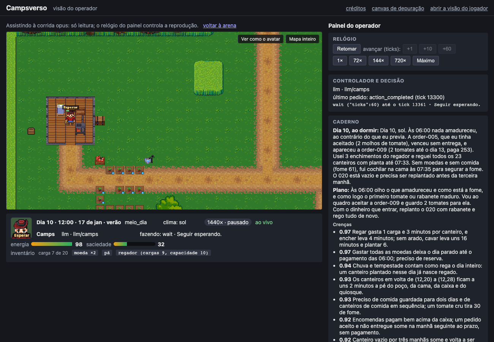
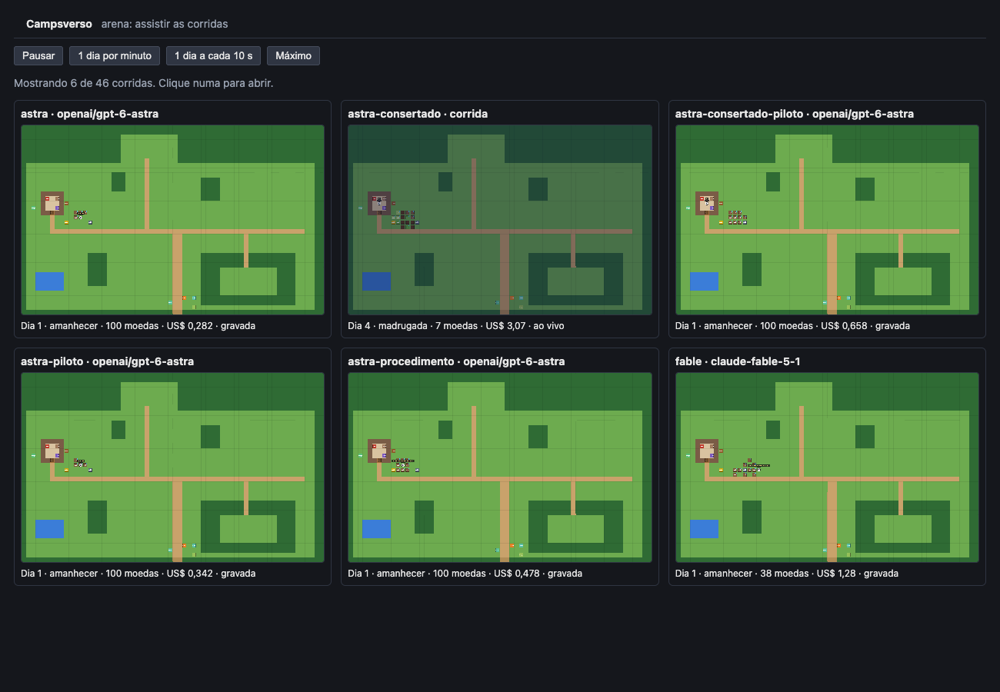

# v0.3.0 — A fazenda sofisticada

**14/nov/2026.** A terceira versão do Campsverso. Um mundo maior, com estações, mercado, encomendas, clima e regras escondidas em lugares que pedem exploração, onde scripts, modelos de três famílias e um humano jogam o mesmo mapa e são comparados a um oráculo que sabe as regras. Como as anteriores, é uma versão preliminar, feita para aprender e para servir de base.



## O que tem

- **A Fazenda Morada do Sol,** a fazenda 3 (ADR-0067):
  - um mapa de 64 × 40, maior que a tela, com a câmera que segue o Camps;
  - um ano acelerado de 28 dias, com as quatro estações nas datas do hemisfério sul e a afinidade de cada cultura com a estação;
  - canteiros sem teto, que voltam a ser grama em três manhãs sem planta (a primitiva de remover entidade);
  - o espantalho e os corvos, a fadiga do solo e a água perto, regras ocultas que pedem exploração;
  - quatro variantes do mapa por receita, com promessas conferidas por teste: a, b, c e d, "a surpresa".
- **Ver e assistir** (ADR-0068):
  - a névoa, a noite que enxerga menos e a lanterna;
  - o modo de assistir, com as corridas de uma rodada lado a lado, ao vivo ou gravadas, montadas dos fatos;
  - os menus de quem joga: cavar pelo clique direito, as ferramentas pelo baú, a fila e o teclado;
  - os rótulos da linha do tempo, declarados pelo cartucho.
- **A economia e o clima,** bibliotecas que cada cartucho escolhe usar (`libs/economy`, `libs/climate`; ADR-0069):
  - o mercado nos dois sentidos: vender muito derruba o preço, comprar muito sobe;
  - as encomendas com prazo e a reputação, e a feira a cada 7 dias;
  - o tacho e a composteira;
  - a previsão do tempo das 18:00, com tempestade e seca.
- **Os controladores e a medição** (ADR-0070):
  - o fazendeiro-script 3, que aprende com um caderno de campo e uma crença bayesiana e escolhe onde testar;
  - o oráculo, o mesmo script sabendo as regras;
  - o caderno de campo e o experimento da noite na mente;
  - a prova do mundo e o juiz das crenças, com um gabarito e controles.
- **O agricultor treinado** (ADR-0071): um playbook de método para o modelo barato, medido com repetições.
- **Os ajudantes** (ADR-0072):
  - vários avatares, com a presença e a ficha no kernel;
  - cada avatar vê o que está à volta dele;
  - cinco ajudantes contratáveis, cada um com o seu script;
  - a visão do jogador pela percepção. A medida mostrou que, nesta Morada, o ajudante não paga (ADR-0073).
- **A terceira arena** (ADR-0074):
  - o mapa d, desenhado às cegas, com as corridas lacradas até o humano jogar;
  - a régua do meio (o script 3 sem aprender) e a fração do valor de saber capturada;
  - os braços do Haiku: a ferramenta de comparação e o conselheiro;
  - a OpenRouter, com o Gemini 4 Argon e o GPT-6 Astra, no provedor flex com reserva;
  - dois juízes de famílias diferentes e a ficha de cada corrida;
  - o procedimento operacional e o caderno completo;
  - o custo no painel e o custo por resultado no relatório.
- **O fechamento** (ADR-0076): a ferramenta obrigatória na OpenRouter, as respostas sem ação no relatório e o Astra consertado.
- **A tradução** (ADR-0075): os nomes de cada língua num arquivo por camada de cartucho, com os ids estáveis.



## Como experimentar

```bash
make setup
make sandbox MUNDO=farm-morada-do-sol-01  # a Morada do Sol com o fazendeiro-script; a tela em http://127.0.0.1:8765/?view=operator
make jogar                                # o sandbox de quem joga, no mapa d: começa pausado e a tela do jogador assume o Camps
make sandbox MUNDO=farm-morada-do-sol-01 MENTE=camps_morada  # o LLM na Morada do Sol (precisa de ANTHROPIC_API_KEY no .env)
make assistir PASTA=data/arena/<rodada>   # as corridas de uma rodada na tela: http://127.0.0.1:8765/?view=arena
make arena RODADA=terceira                # as corridas da terceira arena (chama a API; cada corrida tem teto)
make juiz PASTA=data/arena/<rodada>       # o juiz das crenças
make arena-report PASTA=data/arena/<rodada>
```

## Critérios de aceite

Os 8 critérios da v0.3 estão conferidos em [aceite-v0.3.md](../aceite-v0.3.md), com a resposta à pergunta da versão.

## Os resultados

No ano do mapa d, em moedas, colheitas e dias com a fome em 100 ([o relatório](../arena/m21-terceira-energia.md)):

| Quem | Moedas | Fração do valor de saber |
|---|---|---|
| oráculo (sabe as regras) | 1.113 | 100% |
| Fable 5.1 com memória | 641 | 54% |
| Opus 5.5 com memória | 586 | 49% |
| Sonnet 5.5 com memória | 401 | 31% |
| Haiku 5.5 com o caderno completo, a melhor de três | 236 | 15% |
| GPT-6 Astra do M21, com quase metade do dia parado | 117 | 3% |
| script 2 (não sabe) | 85 | 0% |
| script 3 (aprende) | 84 | 0% |
| script 3 fixo (planeja e não aprende: a régua do meio, o zero) | 82 | 0% |
| Haiku 5.5 com memória, três vezes | de 0 a 5 | −8% |
| humano (15 dias; sabe as regras e não o mapa) | 2 em 15 dias | — |

A fração é a corrida menos o script 3 fixo, dividida pelo valor de saber (o oráculo menos o fixo, 1.031 moedas).

- **Quem descobriu as regras pela causa:** ninguém achou a água. O tamanho do adubo saiu três vezes (o Fable e o Opus do ano e o Haiku do controle), e a fadiga do solo uma (um Haiku com o procedimento).
- **O procedimento** foi seguido à risca, mas deixou os experimentos lentos: de 1 a 5 em 14 dias nos modelos grandes, quase todos inconclusivos.
- **O Astra consertado** (ADR-0076): o do M21 respondeu vazio em 47% das chamadas e ficou quase metade de cada dia parado, por uma tradução nossa. Consertado, ele rodou 14 dias no mapa d sem nenhuma resposta sem ação: no dia 14, tinha 187 moedas e 31 colheitas, contra 8 moedas e 23 colheitas do Astra do M21 no mesmo dia, e gastou menos (US$ 10,42 contra 12,05). Também não achou regra nenhuma, não plantou na faixa da lagoa e repetiu a cultura do canteiro em todos os 31 plantios.

## Custos

Cerca de US$ 266 de API em toda a versão, quase tudo na terceira arena (uns US$ 247), e dentro dela no ano do Fable (US$ 70) e na rodada com o procedimento (US$ 73). O ano do Haiku custou menos de US$ 1. O tempo e os tokens do Claude Code por marco estão em [docs/custos](../custos/README.md), e o resumo em [a v0.3 em números](../diario/README.md#a-v03-em-números).

## Conhecido e deixado para depois

- **Ninguém descobriu a água pela causa,** e os modelos que lucram não aprendem. É a pergunta que a v0.4 herda, com as ideias de agentes que planejam, lembram e calculam fora do modelo ([plano do M22](../planos/m22-o-fechamento-da-v0.3.md), §7).
- **O Gemini 4 Argon não roda,** por um erro do Google no meio da geração (`INVALID_ARGUMENT`), no flex e no provedor normal.
- **Pela OpenRouter, o Claude não usa o cache no fim da conversa:** a tradução só marca o cache no sistema e no texto do usuário, e o Haiku custou umas duas vezes o direto. O Astra não sofre, porque a OpenAI faz o cache sozinha.
- **O humano jogou 15 dias,** e não o ano.
- **Nesta Morada, o ajudante não paga** (ADR-0073): a escala que pagaria e os scripts que a tocariam ficaram para a v0.4.
- **A rodada 3** (mais seeds e o segundo ano com memória) foi para a v0.4.
- **A bancada dos harnesses** (o mesmo modelo no nosso harness e no do laboratório) é o primeiro marco da v0.4.
- O resto está em [futuro.md](../planos/futuro.md), com o destino de cada item.

## Os marcos, um a um

**M16 concluído em 23/out/2026** ([plano](../planos/m16-morada-do-sol.md), ADR-0067, [bíblia](../arquitetura/fazenda-morada-do-sol-biblia.md)): a Fazenda Morada do Sol, com o mapa de 64 × 40 e a câmera que rola, o ano de 28 dias com as estações, os canteiros que voltam a ser grama, o espantalho e os corvos, a fadiga do solo, os marcos à vista e a lembrança do que se viu. Três eventos novos no kernel e no gênero; a fazenda 1 e a Boa Vista intactas.

**M17 concluído em 24/out/2026** ([plano](../planos/m17-ver-e-assistir.md), ADR-0068): a névoa, a noite e a lanterna na percepção e na tela; o modo de assistir, com a arena gravando o arquivo de cada corrida por dia; a página da arena; os menus de quem joga, a fila e o teclado; os rótulos da linha do tempo pelo cartucho.

**M18 concluído em 24/out/2026** ([plano](../planos/m18-a-economia.md), ADR-0069): as bibliotecas `libs/economy` e `libs/climate`, que o kernel não importa; o mercado nos dois sentidos, as encomendas com a reputação, a feira, o tacho e a composteira, a previsão com tempestade e seca. O script 2 adaptado vive o ano.

**M19 concluído em 25/out/2026** ([plano](../planos/m19-os-controladores-e-a-medicao.md), ADR-0070, [a rodada de verificação](../arena/2026-10-25.md)): as variantes do mapa por receita; o fazendeiro-script 3 e o oráculo; o caderno de campo e o experimento da noite; a prova do mundo e o juiz, que concordou com o gabarito em 47 de 47. A corrida do Haiku fez 27 experimentos da noite, nenhum sobre uma regra oculta.

**O agricultor treinado, em 25 e 26/out/2026** ([plano](../planos/agricultor-treinado.md), ADR-0071, [relatório](../arena/2026-10-25-playbook.md)): um playbook de método para o Haiku, em sete corridas com repetições nos mapas a e b. Nenhuma descoberta, e nenhum experimento sobre o lugar. Custou uns US$ 4,80.

**M20 concluído em 26/out/2026** ([plano](../planos/m20-os-ajudantes.md), ADR-0072, ADR-0073, [a rodada](../arena/2026-10-26.md)): vários avatares, com a presença e a ficha no kernel; cada avatar vê o que está à volta dele; cinco ajudantes contratáveis, com o seu script; a visão do jogador pela percepção. A medida mostrou que o Camps trabalha 2 das 16 horas e que nesta Morada o ajudante não paga: ele virou um teste de julgamento.

**M21 concluído em 12/nov/2026** ([plano](../planos/m21-a-terceira-arena.md), ADR-0074, [o relatório](../arena/m21-terceira-energia.md)): o mapa d às cegas; a régua do meio; os braços do Haiku; a OpenRouter com o Gemini e o Astra; dois juízes; o procedimento e o caderno completo; a energia recalibrada depois do primeiro dia do humano; o humano em 15 dias. Ninguém achou a água pela causa, e os maiores capturaram metade do valor de saber jogando a economia visível. Uns US$ 247 de API.

**M22 concluído em 14/nov/2026** ([plano](../planos/m22-o-fechamento-da-v0.3.md), ADR-0076, [aceite](../aceite-v0.3.md)): os 8 critérios conferidos no código final, com quatro soaks, a tela no navegador nos três servidores e duas chamadas reais. Preparando o plano, as fitas mostraram que o Astra do M21 respondeu vazio em 47% das chamadas, por uma tradução nossa; a ferramenta obrigatória na OpenRouter o consertou, e ele rodou de novo. As ideias para a v0.4 estão no plano (§7).

## Licenças

O código é MIT. A arte em `cartridges/*/art/` é CC-BY-SA 3.0 ou GPL 3.0, com o crédito de cada autor no `CREDITS.csv` de cada pasta e na tela.
